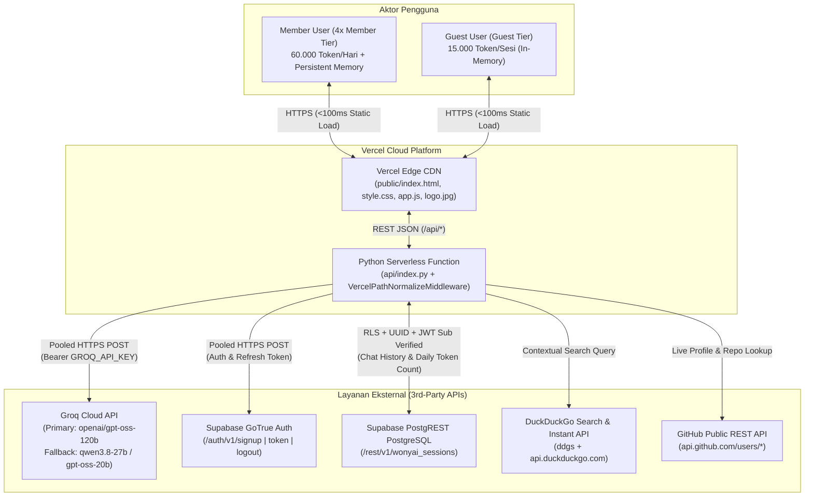
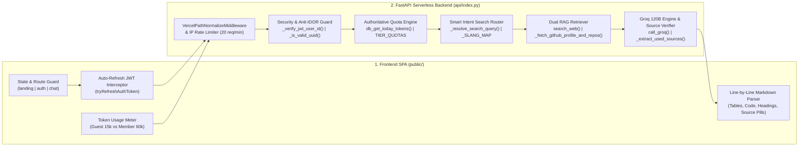
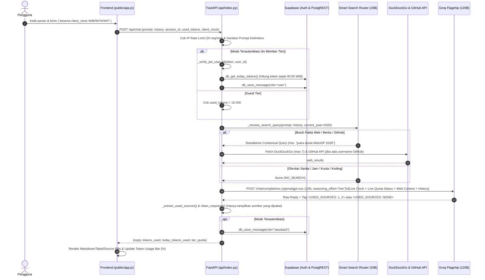

# Dokumentasi Desain Arsitektur Sistem (System Architecture Design) — WonyAI v2.2

**Versi Dokumen:** 2.2.0 (Vercel Edge Static + FastAPI Serverless Architecture)  
**Status:** Production / Live  
**Pemilik Produk:** Emmanuel Abet Rossi Paays ([emmanuel-abet-rossi-paays.vercel.app](https://emmanuel-abet-rossi-paays.vercel.app/))  
**Sumber Kode Utama:** [`api/index.py`](file:///e:/WonyAI/api/index.py), [`public/index.html`](file:///e:/WonyAI/public/index.html), [`public/style.css`](file:///e:/WonyAI/public/style.css), [`public/app.js`](file:///e:/WonyAI/public/app.js), [`vercel.json`](file:///e:/WonyAI/vercel.json)

---

## 1. Ringkasan Eksekutif Arsitektur

**WonyAI v2.2** adalah aplikasi asisten AI personal berbasis web (*cloud-native single-page application*) yang dibangun dengan arsitektur **Decoupled Edge Static Frontend (`public/`) + Python FastAPI Serverless Backend (`api/index.py`)** di atas platform **Vercel**. Sistem ini mengintegrasikan empat komponen layanan utama:
1. **Groq Cloud API (`openai/gpt-oss-120b` + Fallback `qwen/qwen3.8-27b` & `openai/gpt-oss-20b`)**: Mesin inferensi LLM flagship 120 miliar parameter dengan `reasoning_effort="low"` untuk latensi ~1–2 detik, ditambah router pencarian dan generator judul sesi otomatis.
2. **Contextual Web & GitHub RAG (`ddgs` + `api.github.com`)**: Mesin *Retrieval-Augmented Generation* (RAG) waktu-nyata yang dikendalikan oleh *Smart Intent Search Router* (`_resolve_search_query`), kamus ekspansi singkatan Bahasa Indonesia (`_expand_indonesian_slang`), integrasi langsung ke **GitHub REST API** untuk verifikasi profil/repositori developer, serta verifikasi relevansi sumber (`<USED_SOURCES>`) oleh model 120B.
3. **Supabase (GoTrue JWT Auth & PostgREST PostgreSQL)**: Layanan autentikasi berbasis JWT (dengan *automatic background token refresh* `/api/auth/refresh`), penyimpanan memori percakapan lintas perangkat dengan *Row-Level Security* (RLS), serta penghitungan kuota token harian berbasis database (`db_get_today_tokens`).
4. **HTTPS Connection Pooling & OWASP Security Layer**: Menggunakan `requests.Session()` dengan `HTTPAdapter(pool_connections=10, pool_maxsize=20)` + `Retry(total=3)`, validasi kriptografi klaim `sub` & `exp` JWT + UUID v4 anti-IDOR, *server-side sliding-window IP rate limiter*, dan sanitasi anti-*prompt injection* & anti-XSS.

---

## 2. Arsitektur Konteks Sistem (C4 Level 1 — System Context)

---

## 3. Arsitektur Komponen Internal (C4 Level 2 — Component Architecture)

---

## 4. Aliran Pemrosesan Pesan, Contextual RAG & Verifikasi Sumber (Sequence Diagram)

---

## 5. Arsitektur Keamanan (OWASP Hardened Architecture)

| Lapisan Pertahanan | Mekanisme Teknis di [`api/index.py`](file:///e:/WonyAI/api/index.py) & [`public/app.js`](file:///e:/WonyAI/public/app.js) |
|---|---|
| **Anti-IDOR & JWT Verification** | Fungsi `_verify_jwt_user_id()` mendekode payload JWT Supabase, memverifikasi masa berlaku (`exp > time.time()`), dan memastikan klaim `sub` identik dengan parameter `user_id` berformat UUID v4 (`_is_valid_uuid()`). |
| **Authoritative Server-Side Quota** | Pengguna terautentikasi tidak bisa mereset kuota harian melalui *Incognito* atau *Clear Storage* karena `db_get_today_tokens()` menghitung langsung total token dari tabel `wonyai_sessions` di Supabase sejak pukul `00:00 WIB`. |
| **Per-IP Sliding Window Rate Limit** | `_check_ip_rate_limit()` membatasi maksimal 20 request/menit per alamat IP pada endpoint `/api/chat`, `/api/title`, dan `/api/auth/refresh`. |
| **Prompt & Delimiter Sanitization** | `_sanitize_prompt_delimiters()` menghapus tag internal `--- WEB SEARCH ---` dan `<USED_SOURCES>` dari input pengguna untuk mencegah manipulasi konteks RAG. |
| **XSS & HTTP Security Headers** | `escapeHtml()` + NUL-byte code-block sentinels di `public/app.js`, penonaktifan `/docs` & `/openapi.json` di produksi, serta header `X-Frame-Options: DENY`, `X-Content-Type-Options: nosniff`, `Referrer-Policy`, dan `Permissions-Policy` di [`vercel.json`](file:///e:/WonyAI/vercel.json). |
