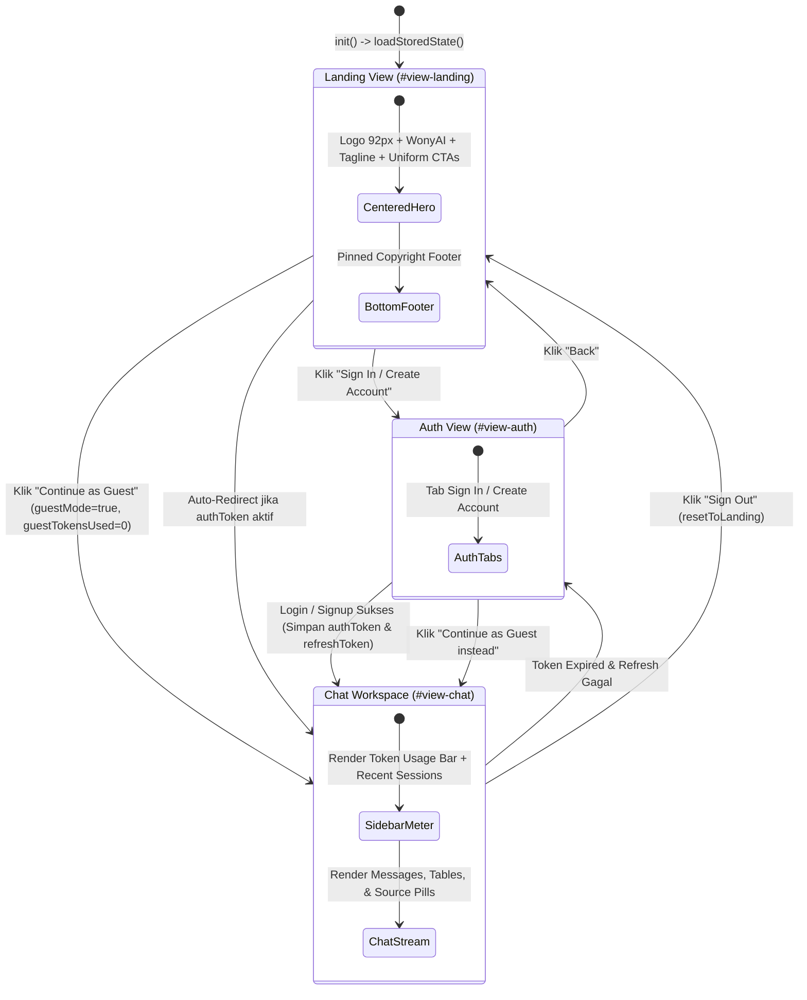
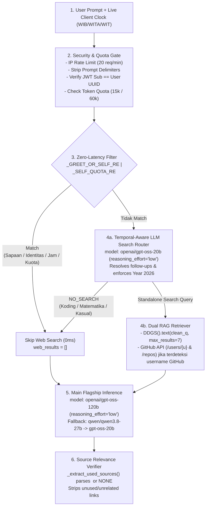

# Technical Blueprint — WonyAI v2.2

**Versi Dokumen:** 2.2.0  
**Target Sistem:** WonyAI Personal AI Assistant (Vercel Serverless + Edge Static SPA)  
**Referensi Implementasi:** [`api/index.py`](file:///e:/WonyAI/api/index.py), [`public/index.html`](file:///e:/WonyAI/public/index.html), [`public/style.css`](file:///e:/WonyAI/public/style.css), [`public/app.js`](file:///e:/WonyAI/public/app.js), [`DESIGN.md`](file:///e:/WonyAI/DESIGN.md)

---

## 1. Tujuan Blueprint

Dokumen **Technical Blueprint** ini merinci mekanisme rekayasa internal, mesin status navigasi (*client state machine*), spesifikasi *Dual-Tier Token Quota*, pipeline *Contextual Web & GitHub RAG* dengan verifikasi sumber `<USED_SOURCES>`, serta sistem desain *Anti-Slop* pada **WonyAI v2.2**.

---

## 2. Mesin Status Navigasi & Sesi Klien (`public/app.js`)

---

## 3. Blueprint Sistem Kuota Dual-Tier (Guest Tier vs 4x Member Tier)

WonyAI menggunakan sistem kuota berbasis **Visible Token Accounting** (hanya menghitung token dari teks prompt pengguna dan jawaban asisten yang tampil di layar, tanpa membebankan *system prompt* atau *internal reasoning tokens* kepada pengguna):

| Parameter Kuota | Guest Tier | 4x Member Tier (Signed-In Account) |
|---|---|---|
| **Batas Token** | **15.000 Token / Sesi** | **60.000 Token / Hari** (4x Lipat Guest) |
| **Sumber Perhitungan & Reset** | *In-memory* (`guestTokensUsed`), otomatis kembali ke `0` saat browser di-*refresh* atau mulai sesi Guest baru. | Dihitung secara otoritatif oleh server dari tabel `wonyai_sessions` Supabase (`db_get_today_tokens`) sejak pukul `00:00 WIB` setiap hari. |
| **Batas Output Maks / Balasan** | `1.500` token | `4.096` token |
| **Memori Konteks Riwayat API** | `4` pesan terakhir | `10` pesan terakhir + tersimpan permanen lintas perangkat |
| **Pembaruan Sesi Login** | Ephemeral | Otomatis diperbarui di latar belakang melalui `POST /api/auth/refresh` (`refresh_token`) |

---

## 4. Blueprint Pipeline Inteligensi, Jam Real-Time & Contextual RAG

---

## 5. Spesifikasi Endpoint REST API (`api/index.py`)

| Metode & Path | Fungsi Utama | Proteksi Keamanan |
|---|---|---|
| `GET /api/config` | Mengembalikan status konfigurasi (`memory_enabled`, `groq_configured`, `model`, `tiers`). | Read-only public config |
| `POST /api/auth/signin` | Autentikasi email & password ke Supabase GoTrue (`/auth/v1/token?grant_type=password`). | Validasi panjang & skema Pydantic |
| `POST /api/auth/signup` | Registrasi akun baru (`/auth/v1/signup`), mengembalikan `token` & `refresh_token`. | Validasi password $\ge 6$ karakter |
| `POST /api/auth/refresh` | Memperbarui `access_token` menggunakan `refresh_token` tanpa login ulang. | `_check_ip_rate_limit()` |
| `POST /api/auth/signout` | Mengakhiri sesi JWT di Supabase (`/auth/v1/logout`). | Bearer token header |
| `GET /api/sessions` | Mengambil daftar sesi pengguna + `today_tokens_used` dari Supabase. | `_verify_jwt_user_id()` + RLS |
| `GET /api/sessions/{session_id}` | Memuat riwayat pesan untuk satu `session_id`. | `_is_valid_uuid()` + `_verify_jwt_user_id()` |
| `DELETE /api/sessions/{session_id}` | Menghapus seluruh pesan dalam satu `session_id`. | `_is_valid_uuid()` + `_verify_jwt_user_id()` |
| `POST /api/chat` | Orkestrasi RAG, inferensi 120B, verifikasi sumber, simpan DB, dan hitung kuota token. | IP Rate Limit + JWT Verify + Quota Check + Sanitizer |
| `POST /api/title` | Membuat judul sesi 2–4 kata dalam Bahasa Indonesia secara asinkron. | `_check_ip_rate_limit()` |
