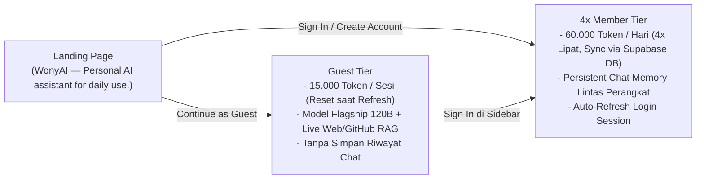

# Product Requirements Document (PRD) — WonyAI v2.2

**Versi Dokumen:** 2.2.0  
**Nama Produk:** WonyAI  
**Tagline Resmi:** *"Personal AI assistant for daily use."*  
**Pemilik Produk:** Emmanuel Abet Rossi Paays ([emmanuel-abet-rossi-paays.vercel.app](https://emmanuel-abet-rossi-paays.vercel.app/))

---

## 1. Visi & Identitas Produk

**WonyAI** adalah asisten AI personal harian yang menggabungkan kecerdasan model flagship **120 miliar parameter (`openai/gpt-oss-120b`)**, kesadaran waktu & data web/GitHub *real-time*, serta memori percakapan lintas perangkat dalam antarmuka gelap minimalis (*"Precise, composed, no fluff"*).

---

## 2. Masalah yang Diselesaikan pada Evolusi v2.2 (Vercel Migration)

| Masalah pada Versi Lama (v1.0 Streamlit) | Solusi pada WonyAI v2.2 (Vercel Serverless + 120B) |
|---|---|
| **Container Tidur & Loading 30 Detik**: Streamlit Cloud mematikan container saat tidak ada trafik dan rawan putus WebSocket di perangkat mobile. | **24/7 Edge Static SPA + FastAPI Serverless**: UI dimuat instan (`< 100ms`) dari Vercel Edge CDN dan berkomunikasi melalui REST JSON dengan *HTTPS Connection Pooling*. |
| **Model 20B Kaku & Kurang Paham Singkatan**: Gagal memahami singkatan chat Indonesia (`"yg menang sp?"`, `"jurdun"`, `"sy"`) dan sering halusinasi tahun 2024. | **Upgrade ke Flagship 120B + Kamus Slang & Jam Real-Time**: Memahami bahasa santai Indonesia, sadar jam/detik WIB/WITA/WIT secara *real-time*, dan otomatis mencari data tahun berjalan (`2026`). |
| **Sumber Web Ngawur pada Obrolan Biasa**: Menempelkan 5 link DuckDuckGo secara paksa meskipun user hanya menyapa atau bertanya hal internal. | **Smart Search Router + Verifikasi `<USED_SOURCES>` + Live GitHub API**: Hanya mencari web saat dibutuhkan dan hanya menampilkan *Source Pills* yang benar-benar dipakai oleh model 120B. |
| **Pembagian Kuota API Key Gratis**: 1 API key Groq Free Tier perlu dibagi secara adil antara pengunjung tamu dan pemilik akun. | **Token Usage Meter (Guest Tier vs 4x Member Tier)**: Guest mendapat `15.000 token/sesi` (reset saat refresh), sedangkan akun login mendapat **4x limit (`60.000 token/hari`)** yang disinkronkan langsung dari database Supabase + *Auto-Refresh JWT*. |

---

## 3. Pengalaman Pengguna & Tiering Produk

---

## 4. Metrik Keberhasilan Produk (KPIs)

1. **Initial Page Load Time**: $< 100\text{ ms}$ melalui Vercel Edge CDN (0% *container hibernation*).
2. **AI Response Latency**: $1.0\text{ – }2.5\text{ detik}$ untuk percakapan langsung (`reasoning_effort="low"`), dan $< 4.5\text{ detik}$ untuk pertanyaan dengan *Contextual Web / GitHub RAG*.
3. **Citation Precision**: $100\%$ *Source Pills* yang tampil di bawah pesan telah melewati verifikasi relevansi `<USED_SOURCES>` oleh model 120B (0 sumber sampah pada obrolan kasual).
4. **Security Compliance**: Lulus seluruh uji verifikasi anti-IDOR (validasi JWT `sub` & UUID v4), *server-side token quota enforcement*, *per-IP rate limiting*, dan sanitasi anti-XSS.
